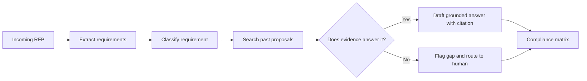
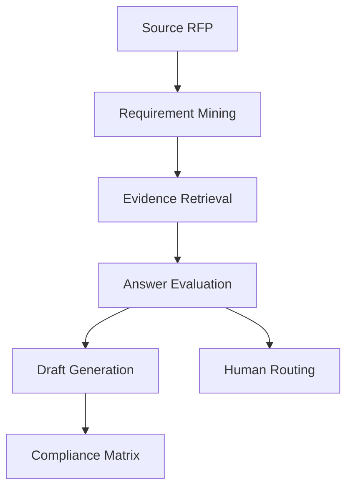

# RFP Automation Project Overview

## 1. One-line summary

This project builds an AI-assisted workflow for reviewing incoming RFPs, extracting the requirements they contain, finding evidence in a company’s past proposals, and either drafting a grounded answer with a citation or routing the item to a human when the answer is truly missing.

## 2. Why this project exists

Large buyers such as governments, banks, universities, and public agencies publish long RFP documents that ask vendors hundreds of questions. Responding to them is expensive, repetitive, and high-stakes. Many answers are already present in prior proposals, but copying them blindly is risky because a proposal is a binding commercial document.

The core problem is not just writing fluent text. The real challenge is making the system behave safely:

- it must find the right evidence,
- it must decide whether that evidence truly answers the requirement,
- and it must refuse to invent an answer when the evidence is missing.

That is why this project focuses heavily on gap detection, grounded evidence, and human routing.

## 3. Project scope

### In scope

- Reading and understanding RFPs and proposals
- Extracting discrete requirements from long procurement documents
- Searching a knowledge base of past proposals for candidate evidence
- Evaluating whether a retrieved passage genuinely answers a requirement
- Drafting a compliant response with a citation
- Routing hard or missing cases to a human reviewer
- Measuring performance with a hand-verified golden set

### Out of scope

- Building a full production SaaS product in this internship pack
- Deploying a live workflow or integrations
- Claiming accuracy without human-verified evidence
- Assuming that similarity alone is enough to detect gaps

## 4. Core workflow

## 5. Primary use cases

### 1. Proposal drafting support
A bid team can use the system to accelerate response generation by reusing past content that has already been approved.

### 2. Compliance assurance
The system helps ensure that no requirement is missed, because every output can be traced back to an evidence source and a review status.

### 3. Gap detection and risk control
When a buyer asks something the company has never actually answered before, the system should refuse and escalate instead of inventing a response.

### 4. Knowledge reuse across similar procurements
A library of proposals can be used as a reusable memory for future bids, reducing repeated drafting effort.

## 6. Common challenges

### Requirement mining
RFPs are not neatly formatted Q&A sheets. Requirements appear inside dense prose, are split across pages, and often contain multiple sub-requests in one sentence.

### Scope substitution
A passage about one service line may sound relevant to another. This is a major failure mode: an answer about general banking is not the same as an answer about lockbox, even if the topic is related.

### Hallucinated or overconfident answers
The biggest risk is not poor wording. It is confidently generating an answer that is unsupported by the evidence base.

### Limited verified negatives
The safety case depends on having genuine examples of questions that the library cannot answer. These are rare and expensive to create, which is why the golden set matters so much.

### Evidence quality and citation accuracy
A system may appear useful while still producing invalid or weak citations. That is why the project emphasizes quote verification and page-level grounding.

## 7. Special features of this project

### Grounded answers
The product is designed to generate answers that are tied to a citation and source passage rather than free-form, unsupported prose.

### Safe refusal behavior
The system is expected to say “I cannot answer this from the available evidence” rather than inventing content.

### Human routing
Some items are deliberately handled by a human because they involve legal, pricing, or policy-sensitive content.

### Evidence-first evaluation
The project does not rely on intuition alone. It uses hand-reviewed annotations, quotes, and verifiable checks to measure quality.

### Compliance-matrix output
The deliverable is not just a draft answer. It is a structured matrix that shows whether each requirement was answered, partially answered, or left unresolved.

## 8. Key success metrics

The project tracks several important measures:

- Gap recall: how often the system correctly identifies a requirement that cannot be answered from the library
- False refusal rate: how often it refuses something it should have answered
- Citation validity: whether the cited page truly supports the answer
- Human review burden: whether the system reduces or increases manual effort

## 9. Project philosophy

The project is governed by a simple but important principle:

> Evidence before assertions.

If the system cannot support an answer, it should not pretend it can. That principle is central to the design, evaluation, and workflow of the project.

## 10. High-level architecture

## 11. Summary

This internship project is less about generic AI writing and more about trustworthy, evidence-based proposal support. Its value comes from helping a company answer procurement questions safely, consistently, and with clear traceability.
