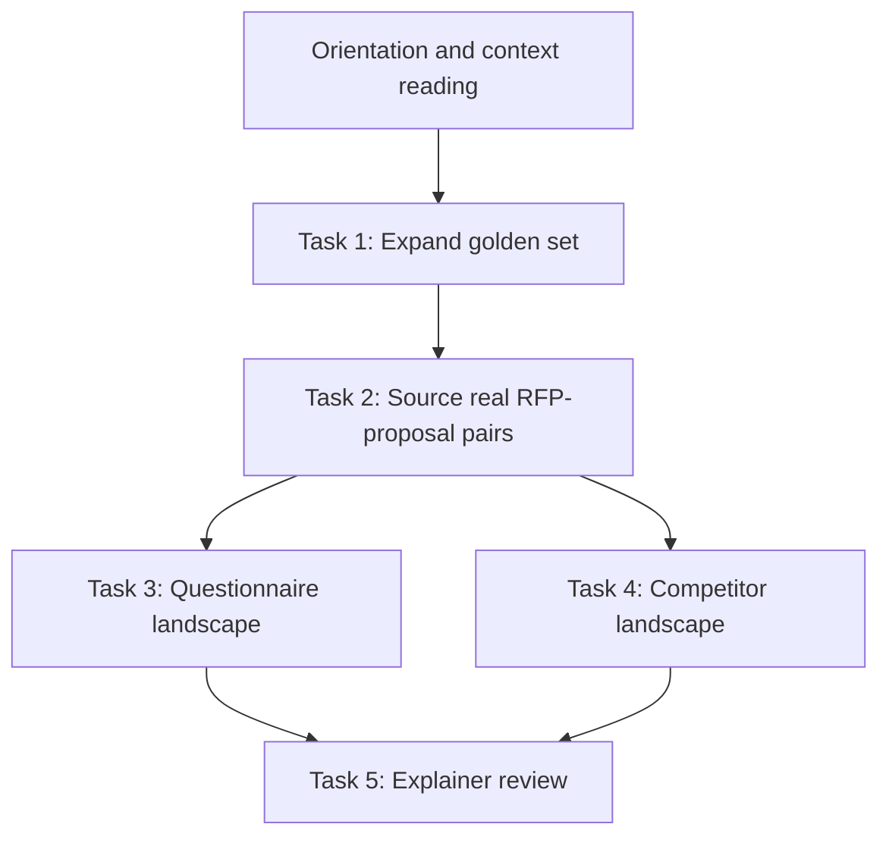
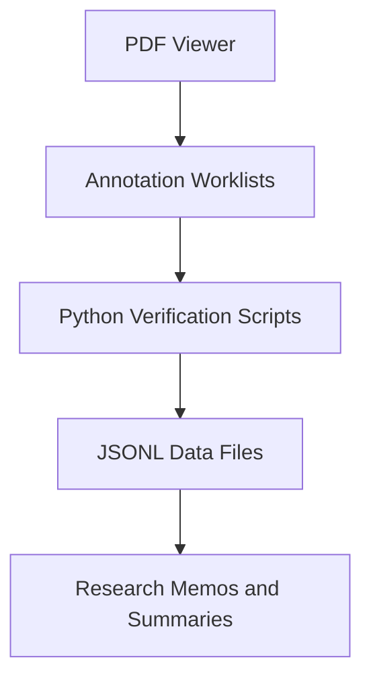

# Internship Roadmap for RFP Automation Tasks

## 1. Objective

This roadmap turns the internship pack into a practical execution plan. The goal is to produce a reviewable evidence package and research outputs in the workspace while building understanding of the problem, the data, and the evaluation strategy.

## 2. What you are expected to deliver

Your work should be stored in the workspace under the project’s work folder and should include:

- annotated evidence rows for the golden set,
- a source-candidate log for real RFP/proposal pairs,
- research memos on questionnaires and competitors,
- a review of the project explainer,
- daily notes and questions that make the work auditable.

## 3. Roadmap overview

## 4. Phase-by-phase plan

### Phase 0 — Orientation

**Focus:** learn the domain and understand the project constraints.

**Activities**
- Read the project introduction and task briefs
- Review the glossary and working principles
- Understand the meaning of grounded answers, gaps, and true negatives
- Review the verification workflow and annotation format

**Outcome**
A strong mental model of the product, the evaluation setup, and the risk of overconfident answers.

### Phase 1 — Task 1: Expand the golden set

**Goal:** create more hand-verified examples for evaluating whether the system can detect unanswerable questions.

**Why it matters**
The current safety signal depends on a very small number of verified negatives. This task expands the evidence base and improves confidence in the evaluation.

**Main work**
- Review the existing annotation examples
- Label requirements as answered, partial, or none
- Record quotes and page numbers
- Use the verification script to check each row

**Deliverable**
A larger annotated golden set, split across the two provided worklists.

### Phase 2 — Task 2: Source real RFP/proposal pairs

**Goal:** find additional genuine document pairs beyond the one already available.

**Why it matters**
The project currently relies on a single real pair. More pairs would make the evaluation much more robust and generalizable.

**Main work**
- Search for public procurement portals and published proposals
- Check whether each candidate is a genuine submitted proposal
- Record evidence of what works and what does not
- Capture dead ends and blocked sources as part of the findings

**Deliverable**
A sourcing log, supporting documents, and a memo summarizing where real pairs are available.

### Phase 3 — Research tasks

#### Task 3: Questionnaire landscape
**Goal:** assess whether the product should pivot toward questionnaires instead of RFPs.

**Focus**
- Review real questionnaires such as SIG and CAIQ
- Compare their structure to RFPs
- Assess whether completed questionnaire data is publicly available

#### Task 4: Competitor landscape
**Goal:** understand who else is building similar tools and where the market gap might be.

**Focus**
- Study RFP-response and AI-native competitors
- Compare claims, pricing, and capabilities
- Look specifically for whether any tool treats gap detection or safe refusal as a first-class feature

### Phase 4 — Task 5: Explainer review

**Goal:** review the project explainer as a newcomer and identify where it is confusing or incomplete.

**Focus**
- Note unclear concepts and missing explanations
- Record where the documentation could be improved
- Capture disagreements and gaps in the project narrative

**Deliverable**
A review memo with concrete feedback on how the project is explained.

## 5. Suggested timeline

| Time | Focus | Output |
|---|---|---|
| Day 1 | Orientation and explainer review | Initial notes and questions |
| Days 2–5 | Task 1 annotation work | First batch of verified rows |
| Days 6–7 | Finish Task 1 and summarize findings | Annotation summary |
| Days 8–10 | Task 2 sourcing research | Source-candidate log and findings |
| Days 11–12 | Task 3 or Task 4 | Research memo |
| Final days | Finish remaining work and polish | Final deliverables |

## 6. Tech stack and tools

### Core tools

- Python 3.9+ for verification and scripting
- JSONL for structured annotation data
- PDF documents and page-level text extraction
- Markdown for documentation and research memos
- VS Code and terminal workflows for editing and verification

### Why these tools matter

The work is less about building a large application and more about careful data handling, evidence validation, and clear documentation. The repository already provides the tools needed to inspect, verify, and structure the work.

## 7. Deliverables map

| Task | Deliverable | Location |
|---|---|---|
| Task 1 | Annotated worklists and summary | your-work/ |
| Task 2 | Source log and sourcing findings | your-work/ |
| Task 3 | Questionnaire landscape memo | your-work/ |
| Task 4 | Competitor landscape memo | your-work/ |
| Task 5 | Explainer review memo | your-work/ |

## 8. Success criteria

You will be successful if you:

- follow the evidence-first workflow,
- produce clear and checkable outputs,
- document ambiguity instead of guessing,
- keep your work reviewable through logs and questions,
- and leave the repository with a strong trail of reasoning behind every conclusion.

## 9. Final note

This internship is not just about finishing tasks. It is about learning how to make careful, auditable decisions in a domain where overconfidence is expensive.
